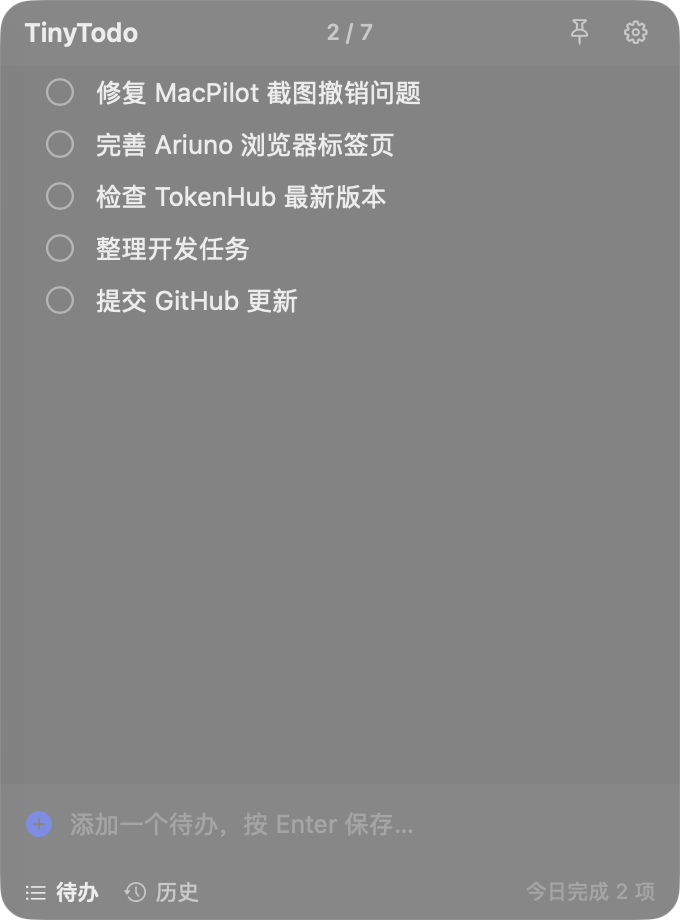

# TinyTodo

> A tiny todo, always within reach. 记录，不应该成为负担。

原生 macOS 常驻待办小窗口：打开电脑就能看到、随手记一条、点一下勾掉，完成历史永久保留。
**完全本地运行**，不联网、不账号、不上传任何数据。



---

## 中文

### 定位

TinyTodo 不是 Things 3 / Todoist 那种任务管理器，而是一个随时可见的小窗口：

- 打开电脑就能看到待办。
- 添加任务只需一次输入、一次回车。
- 完成任务只需点击一次。
- 已完成任务进入历史记录，永久保留，不自动丢弃。
- 误操作随时撤销。

只解决五件事：快速记录、快速勾选、始终显示、查看历史、随时撤销。不做项目管理、团队协作、账号系统。

### 功能

| 能力 | 说明 |
| --- | --- |
| 原生悬浮窗口 | AppKit `NSPanel`，默认置顶、跨 Spaces、全屏应用旁可见、可拖动可缩放、记住每个显示器的位置 |
| 快速记录 | 底部输入框，Enter 保存并清空，可连续输入；粘贴多行文本自动拆成多条（自动去掉 `- `、`* `、`[ ]` 等前缀） |
| 中文输入法 | 拼音组合期间按 Enter 只确认候选词，不会误创建半截任务；输入控件为 `NSTextView` 包装，显式检查 `hasMarkedText()` |
| 完成与撤销 | 单击圆圈完成，立即移出待办、写入完成时间；`⌘Z` 或 Toast 上的「撤销」按钮恢复，回复到原排序位置 |
| 历史记录 | 按本地日期分组（今天 / 昨天 / 最近 7 天 / 30 天）、按月查看、搜索、每天完成数量、累计完成数、恢复到待办、删除记录 |
| 本地存储 | SQLite + GRDB，WAL 模式，事务写入，版本化迁移，崩溃后可恢复；历史永不自动清理 |
| 备份 | JSON 导入 / 导出（ISO-8601 时间戳），导入按 id 合并，不清空现有数据 |
| 菜单栏 | 左键在图标下展开应用自绘面板（类似 Magpie），点击外部收起；图标显示剩余待办数；右键菜单（待办/今日完成、快速添加、历史、检查更新、设置、退出） |
| 在线更新 | 设置 › 更新检查 GitHub `releases/latest`；校验 SHA-256、版本、Developer ID 团队、designated requirement 与公证后，自替换 `/Applications` 内应用并重启 |
| iCloud 存储 | 设置 › 数据 › 使用 iCloud Drive…：SQLite 单文件放在所选文件夹，由 iCloud 同步到其他 Mac；切换时可选保留哪边数据并重启 |
| 菜单栏计数 | 状态栏图标显示**剩余待办数**（1.2.1 起；1.1.0 及更早显示今日完成数），菜单中同时列出待办与今日完成 |
| 全局快捷键 | 默认 `⌥⇧T`，Carbon 注册，不需要辅助功能权限；可在设置中修改并检测冲突 |
| 设置 | 外观（跟随系统/浅色/深色）、窗口透明度、置顶、跨桌面、菜单栏计数、开机启动、快捷键、数据库位置/版本/大小、重置窗口位置 |

### 快捷键

| 操作 | 快捷键 |
| --- | --- |
| 呼出 / 隐藏窗口（全局） | `⌥⇧T`（可改） |
| 新建待办 | `⌘N` |
| 搜索历史 | `⌘F` |
| 撤销 | `⌘Z` |
| 打开设置 | `⌘,` |
| 隐藏窗口 | `Esc` |

### 技术架构

| 层 | 选择 |
| --- | --- |
| 语言 | Swift 5 语言模式（Xcode 26 / Swift 6.3 编译器），macOS 14+ |
| UI | SwiftUI |
| 窗口 | AppKit `NSPanel`（`FloatingPanelController`） |
| 存储 | SQLite + [GRDB 7.12](https://github.com/groue/GRDB.swift)（vendored） |
| 状态 | Observation（`@Observable`） |
| 快捷键 | [KeyboardShortcuts 3.1](https://github.com/sindresorhus/KeyboardShortcuts)（vendored） |
| 开机启动 | `SMAppService.mainApp` |
| 配置 | `UserDefaults` |

**为什么不是纯 SwiftUI 窗口？** 置顶、跨 Spaces、全屏辅助、失焦不隐藏、逐显示器记忆位置这些行为，需要 `NSPanel` 级别的控制。SwiftUI 只负责绘制内容。

线程模型：数据库读写全部异步（GRDB queue），主线程只更新 UI；待办列表通过 `ValueObservation` 推送，历史页按需查询，无定时轮询。空闲 CPU ≈ 0%。

### 数据

默认本机位置：

```
~/Library/Application Support/TinyTodo/
├── TinyTodo.sqlite
├── TinyTodo.sqlite-wal
└── TinyTodo.sqlite-shm
```

iCloud 模式（设置 › 数据 › 使用 iCloud Drive…）把 `TinyTodo.sqlite` 放在用户选择的 iCloud Drive
文件夹，使用 `journal_mode=DELETE` 的单文件写入，由 iCloud 负责同步。切换存储位置会复制数据并备份旧库，
之后需要重启应用。iCloud 是文件级同步，不做冲突合并，建议同一时间只在一台 Mac 上编辑。

```sql
CREATE TABLE todos (
    id TEXT PRIMARY KEY,
    title TEXT NOT NULL,
    status INTEGER NOT NULL DEFAULT 0,      -- 0 未完成 / 1 已完成
    created_at REAL NOT NULL,               -- Unix 时间戳
    updated_at REAL NOT NULL,
    completed_at REAL,
    sort_order INTEGER NOT NULL DEFAULT 0
);
```

历史记录不是另一份数据，而是 `status = 1` 的同一批行，因此不存在待办与历史不同步的问题。迁移只增不改：v1 建表与索引，v2 增加搜索索引，v3 增加待办排序索引，升级不触碰任何历史行。

### 构建

要求：macOS 14+、Xcode 26（Swift 6.3 编译器）。

```bash
# 工程文件已提交；若修改 project.yml 可重新生成
xcodegen generate

# 构建
xcodebuild -project TinyTodo.xcodeproj -scheme TinyTodo -destination 'platform=macOS' build

# 单元 + 集成测试（111 个）
xcodebuild -project TinyTodo.xcodeproj -scheme TinyTodo -destination 'platform=macOS' test

# 开发用 ad-hoc DMG
bash scripts/make_dmg.sh

# 正式分发：Developer ID 签名 + Apple 公证 + staple（详见 docs/RELEASE.md）
bash scripts/release.sh
bash scripts/notarize.sh
```

也可以直接 `open TinyTodo.xcodeproj`，选择 TinyTodo scheme 运行。App 为 `LSUIElement`，没有 Dock 图标，从菜单栏或 `⌥⇧T` 唤出。

依赖以源码形式放在 `Vendor/`（GRDB 7.12.0、KeyboardShortcuts 3.1.0，均为 MIT），因此**离线可构建**，CI 不需要拉取远端包。升级依赖时替换对应目录并重新 `xcodegen generate`。

### 测试

- `TinyTodoTests`：111 个单元/集成测试，覆盖创建/批量创建/并发创建、完成与撤销、排序、重命名、删除恢复、历史搜索与日期过滤、今日统计、WAL、重启持久化、v1→v3 迁移不丢数据、JSON 导入导出、按天分组（含夏令时）、撤销栈、视图模型流程、真实 `NSPanel` 的置顶/Spaces/透明度/帧持久化。
- `TinyTodoUITests`：XCUITest 覆盖启动出窗、输入创建、勾选完成进入历史、历史页、设置窗口、以及「自动化窗口落在非主屏」。UI-test 模式下 `TestScreenPolicy` 会把面板和设置窗口放到非主显示器，避免占用用户正在工作的屏幕。XCUITest 需要给测试运行器授予「辅助功能/自动化」权限（系统设置 › 隐私与安全性 › 辅助功能）；CI 只编译该测试包（GitHub 托管 runner 无登录 GUI 会话）。
- GitHub Actions：`.github/workflows/build.yml` 在 `macos-latest` 上构建 Release、跑测试、打出 DMG 并上传 artifact。

### 已知限制

- 1.0.x 没有更新组件：升级到 1.1.0 需要手动安装一次 DMG；从 1.1.0 起可在应用内检查并安装后续更新。
- iCloud 为文件级同步：两台 Mac 同时编辑可能以最后写入为准，不做逐条合并。
- 1.0 不含 iCloud 同步、到期提醒、子任务、标签/项目、AI 功能（按产品范围刻意不做）。
- 发布用 DMG 由 `scripts/release.sh` + `scripts/notarize.sh` 产出：Developer ID 签名、Hardened Runtime、secure timestamp，app 与 DMG 均已公证并 staple；凭据与流程见 [docs/RELEASE.md](docs/RELEASE.md)。`scripts/make_dmg.sh` 仅用于本地 ad-hoc 测试包。
- UI 文案为中文；代码与数据格式与语言无关。
- 内存实测 Release 构建 phys_footprint ≈ 26 MB（空闲 30 秒无增长；`ps` 的 RSS 会把共享库算进来，约 110 MB）。

### 许可

[MIT](LICENSE) © 2026 TinyTodo contributors.

---

## English

TinyTodo is a native macOS menu-bar todo panel that stays on screen. It is deliberately small:

- see your todos the moment you log in,
- capture one with a single line and Return,
- complete it with a single click,
- keep every completed item in permanent history,
- undo mistakes instantly.

No accounts, no network, no cloud. Everything lives in a local SQLite database.

### Highlights

- **Real AppKit `NSPanel`**: always-on-top by default, joins all Spaces, acts as a full-screen
  auxiliary window, survives app switches, draggable/resizable, remembers a frame per display.
- **One-field capture** with IME safety: Return during Pinyin composition confirms the candidate
  instead of creating a half-typed todo. Multi-line paste becomes multiple todos.
- **Complete → history** with `completed_at`; `⌘Z` (or the toast action) restores the item at its
  original position. Delete, reorder and rename are undoable too.
- **History** grouped by local day, month picker, search, per-day counts, restore to todo,
  delete record, cumulative total.
- **SQLite + GRDB** in WAL mode with additive migrations (v1 → v3); history is never auto-purged.
- **JSON export/import** with ISO-8601 timestamps; import merges by id.
- **Global hotkey** `⌥⇧T` registered through Carbon, so no Accessibility permission is required.
  Configurable with conflict detection. `⌘N` new, `⌘F` search history, `⌘Z` undo, `⌘,` settings.
- **Menu bar**: left click expands the panel as the app's own dropdown under the icon (Magpie-style, dismisses on outside click); the badge shows the remaining todo count; right click (or Control-click) opens the menu with remaining/today counts, quick add, history, updates, settings and quit.
- **iCloud Drive storage**: Settings › 数据 › 使用 iCloud Drive… stores `TinyTodo.sqlite` in a folder you
  pick in iCloud Drive (single-file journal so iCloud replicates it), with conflict choice on switch,
  a timestamped local backup when switching back, and a restart prompt.
- **Online updates**: Settings › 更新 (or menu bar › 检查更新…) checks GitHub `releases/latest`,
  verifies the DMG's SHA-256 digest, bundle id/version, Developer ID team, designated requirement
  and notarization, then swaps the `/Applications` bundle via a helper and relaunches.
- **Settings**: appearance, panel opacity, always-on-top, Spaces, menu bar count, launch at login
  (`SMAppService`), hotkeys, database info, reset window position.

### Architecture

Swift 5 language mode on the Swift 6.3 compiler, macOS 14+. SwiftUI draws the content; AppKit owns
the window (`FloatingPanelController`, `ScreenManager`, `WindowStateManager`). GRDB runs all reads
and writes off the main thread; the pending list is pushed through `ValueObservation`, history is
queried on demand. Idle CPU is ~0%.

Data lives at `~/Library/Application Support/TinyTodo/TinyTodo.sqlite` (+ `-wal`, `-shm`).
Schema: one `todos` table (`status` 0/1, `completed_at`), with indexes for pending ordering and
history search. Migrations are additive only, so upgrades never touch existing history rows.

### Build, test, package

Requires macOS 14+ and Xcode 26.

```bash
xcodegen generate                                    # only after editing project.yml
xcodebuild -project TinyTodo.xcodeproj -scheme TinyTodo -destination 'platform=macOS' build
xcodebuild -project TinyTodo.xcodeproj -scheme TinyTodo -destination 'platform=macOS' test
bash scripts/make_dmg.sh                             # ad-hoc dev DMG
bash scripts/release.sh                              # Developer ID signed Release
bash scripts/notarize.sh                             # notarize + staple app and DMG
```

Dependencies are vendored under `Vendor/` (GRDB 7.12.0, KeyboardShortcuts 3.1.0, both MIT), so the
project builds offline and CI needs no package downloads.

### Testing

111 unit/integration tests cover the repository, migrations (including a v1 database upgrade that
keeps history rows), JSON import/export, day grouping (DST included), undo, view-model flows and the
real panel's level, Spaces behavior, opacity and frame persistence. XCUITest covers launch, create,
complete, history, settings, and that the automation window lands on a non-main display. UI tests need
Accessibility authorization for the test runner, so CI only compiles the XCUITest bundle.

### License

[MIT](LICENSE) © 2026 TinyTodo contributors.
